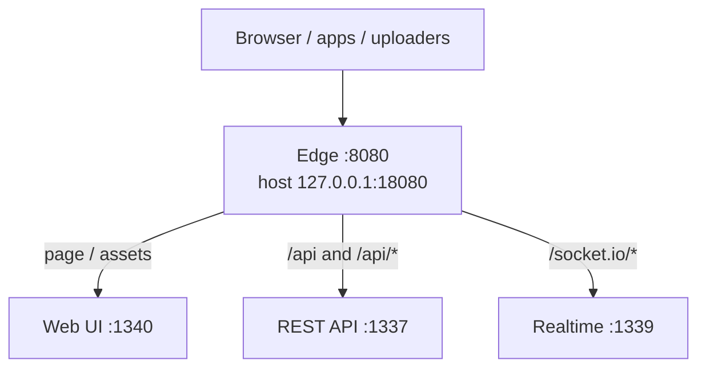
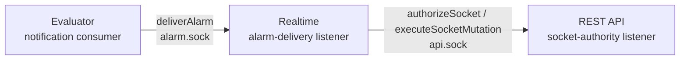
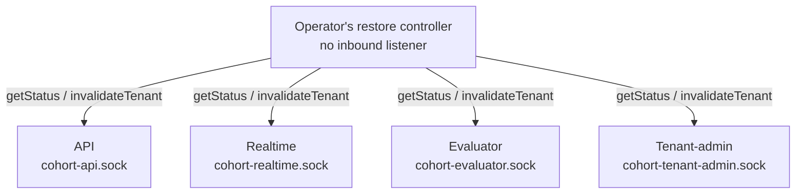

# Component interfaces and traffic

**Read-derived** from the separate-role synthetic reference in
[`compose.yaml`](../deploy/multitenant/compose.yaml),
[`config.js`](../deploy/multitenant/config.js),
[`nginx.conf`](../deploy/multitenant/nginx.conf), the
[`role launcher`](../lib/server/serve/index.js) and the
[internal service contracts](internal-service-api.md). These diagrams describe
the binding; they are not a measurement of a running deployment or an assertion
that its ports are universal defaults. The deployment companion owns packaging
as that reference moves out of core.

An interface is a contract and audience. A listener is a bound socket/address.
A deployment process may compose roles, but private operations must still have
an independently bound listener from consumer/management HTTP. They are never
mounted onto the public router. An unpublished HTTP port is not automatically
an internal contract: tenant-admin's management contract is distinct from its
private lifecycle contract even though neither is published by the reference
edge.

## Private API categories and deployment bindings

Both application operations and lifecycle operations are **private APIs**.
"Lifecycle" describes their purpose, not a different network, protocol or class
of transport. The diagrams separate traffic by purpose to make the connections
readable:

- Private application calls carry socket authority decisions, socket mutations
  and notification handoff.
- Private lifecycle control carries participant status and tenant invalidation
  for claim-bound restore coordination.
- Operational health/readiness/metrics would be another private API category.
  The evaluator currently returns an in-process `health()` result and serves its
  lifecycle participant contract; this does not establish a remote `/metrics`
  endpoint. A worker can serve an operational API without a consumer data API.

Each `.sock` filename in the reference inventory is an HTTP listener binding.
It is not a separate wire protocol, and application callers use the same service
contract and named methods with an explicit TCP/HTTP endpoint. The local
filesystem ownership checks apply to the UDS deployment; the HTTP deployment
uses its configured network boundary.

The current transport binds **one service contract per listener**. Consequently
API and realtime each have separate application and lifecycle listeners. This
allocation is an implementation choice, not a consequence of separating public
and private interfaces. Multiple explicit contract modules could share one
component's private listener without putting any of them on its public listener.
That composition is not implemented by the current single-service dispatcher;
it would require a fixed server-owned method/path registry, collision checks,
per-operation schemas and preserved authorization/lifecycle semantics. A request
must never select an arbitrary handler or load an arbitrary contract.

## Listener inventory

| Deployable component / job | Consumer or management interface in the reference | Internal service listener in the reference | Outbound traffic |
|---|---|---|---|
| Edge (nginx) | Container TCP `:8080`, published at host `127.0.0.1:18080` unless overridden | None | UI, API and realtime consumer HTTP |
| Web UI | `0.0.0.0:1340`, page/assets | None | No backend service calls in this static-page server; the browser makes data/socket calls through the edge |
| REST API | `0.0.0.0:1337`, API routes | `/run/ns-ipc/api.sock` (`socket-authority`); `/run/ns-ipc/cohort-api.sock` (`lifecycle-participant`) | PostgreSQL and configured secrets provider (Vault Transit in this reference) |
| Realtime | `0.0.0.0:1339`, Socket.IO plus health | `/run/ns-ipc/alarm.sock` (`alarm-delivery`); `/run/ns-ipc/cohort-realtime.sock` (`lifecycle-participant`) | API internal service and PostgreSQL |
| Evaluator / notification consumer | No consumer HTTP listener | `/run/ns-ipc/cohort-evaluator.sock` (`lifecycle-participant`) | PostgreSQL; realtime alarm handoff; other providers only when explicitly selected |
| Tenant-admin | `0.0.0.0:1341`, owner management; not routed by this nginx binding | `/run/ns-ipc/cohort-tenant-admin.sock` (`lifecycle-participant`) | Scoped PostgreSQL readers/writers |
| Bootstrap / restore tools | No inbound listener; operator-invoked jobs | Client of participant contracts, not an extra server | PostgreSQL, selected API requests; bootstrap also provisions Vault |
| PostgreSQL | No consumer listener | PostgreSQL TCP `:5432` on backend network | Responses to role-scoped database clients |
| Vault | No consumer listener | HTTPS `:8200` on backend network | Responses to configured provider and bootstrap calls |

Only nginx is host-published by the reference Compose file. Backend listeners
bind inside their containers and the backend network is internal. That reference
edge uses HTTP; deployment TLS termination is a separate binding choice.
The operator's management binding must be explicit; this nginx configuration does
not silently expose tenant-admin or private lifecycle operations.

## Consumer ingress

The fan-out has one source and a single row of destinations. Arrows show the
request initiator; responses use the same connection.

Authorized owner/operator clients use an explicitly selected tenant-admin
management binding. Its management API is separate from its lifecycle listener.

## Internal application calls

These are different operations, not a generic request-proxy chain. Evaluator
initiates notification handoff to realtime. Realtime separately asks the API for
current socket permissions and forwards client writes/acknowledgements to it.
Delivery also checks each recipient's current permission, so notification fanout
can itself cause authority calls. The frequency and cost of those calls are not
measured by the topology diagram.

Realtime remains a reader of clinical projections. Client writes and alarm
acknowledgements go to the API's existing authorized executor. Alarm acceptance
is fanout handoff, not device acknowledgement; a lost response can cause retry
delivery. The [API reference](internal-service-api.md) owns errors, schemas,
timeouts and replay rules.

## Private restore coordination

The controller also has its separately authorized PostgreSQL connection.
These private calls inspect real participants and invalidate their actual
tenant state. They do not replace the database claim/drain/census checks. See
[tenant operation cohorts](tenant-operation-cohort.md) for the complete protocol.

## Data and secrets

All serving roles connect to PostgreSQL through separate role-scoped connections.
API owns clinical client writes; realtime and evaluator can persist their own
checkpoint/projection/notification state. Tenant-admin's scoped management writes
and the maintenance tool's restore authority are different responsibilities.
No shared connection identity is implied by a single database box.

The API's configured secrets provider calls Vault Transit over HTTPS in this
reference. Bootstrap provisioning also calls Vault. Optional identity-provider,
Vault Agent and external notification-provider traffic belongs to the binding or
capability that selects it and is not implied by these reference diagrams.

## Replacing a Unix socket with private HTTP

Each internal endpoint can use an explicit HTTP origin and optional bind address;
for example, a caller addresses `http://api-internal:9081/` while the API's
separate internal server binds `0.0.0.0:9081`. The lifecycle participant uses
another distinct endpoint. The public API remains on its own listener.

`9081` is an example, not a reserved or default port. Link-local addresses such
as `169.254.1.1` and Kubernetes Service DNS names are supported when assigned and
routed by the deployment. The endpoint descriptors and their environment
references are specified in [the transport configuration](internal-service-api.md#deployment-endpoint-descriptors).
There is no loopback-only restriction or new bearer protocol. The deployment
owns network reachability, TLS/proxy/mesh policy if selected and listener placement;
service/version headers identify the expected contract.

Transport flexibility does not by itself establish multi-host restore admission,
high availability, a scalable evaluator partition or external provider delivery.
Existing credential, tenant and lifecycle gates remain required.

The role catalogue also names `vcpool` and platform `admin`, but they have no
selected runnable constructor in this reference. They are not presented here as
deployed services.

## Edge enforcement and application authority

The reference nginx binding already handles reverse proxying and the WebSocket
upgrade/tunnel. Realtime implements the Socket.IO protocol, namespace and tenant
subscriptions, application fanout and current permission checks. It is not a
general-purpose replacement for nginx.

An edge authorization adapter can be a separate private contract for nginx
`auth_request` or a gateway decision API. It needs an explicit status-code,
original-request metadata, tenant-resolution and trusted-header contract.
Nginx's [authorization subrequest contract](https://nginx.org/en/docs/http/ngx_http_auth_request_module.html)
uses successful status for allow and 401/403 for deny. The socket authority
operation's JSON `{denied:true}` success response is therefore not directly
compatible. Ory Oathkeeper supports both
[reverse-proxy and decision-API placement](https://www.ory.com/docs/network/oathkeeper).

Gateway decisions can control connection admission and HTTP request routing.
After a WebSocket upgrade, nginx
[tunnels the connection](https://nginx.org/en/docs/http/websocket.html); the initial
HTTP decision does not authorize each later Socket.IO message, subscription,
fanout recipient or database mutation. Those existing application gates remain
required. Any identity headers supplied by an edge adapter need a defined trusted
ingress boundary and stripping/replacement of client-supplied copies. No such
adapter or new trusted-header behavior is selected by this documentation.

## Maintaining the current views

The [API reference](internal-service-api.md) owns current API semantics and links
to executable schemas. This page owns the current listener inventory and
traffic diagrams. The executable schemas, role constructors and selected
deployment binding remain the facts those views describe; review their diagrams
when any of those inputs changes. Diagram labels distinguish observed code,
reference addresses and unimplemented composition choices.

Dated test captures and acceptance reports retain their original source and
scope. They are evidence, not a second current architecture guide. When older
design prose is superseded, redirect current navigation to these current views
and preserve the historical material with its original attribution. This update
does not archive measurements or declare a new deployment accepted.
