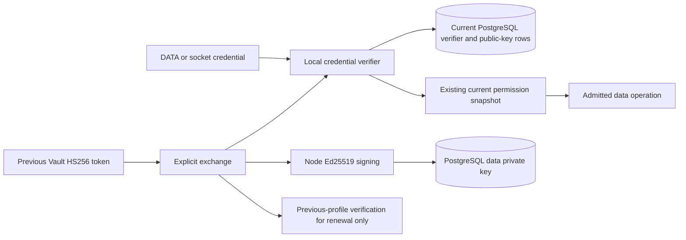

# Dormant tenant legacy credential verifier

> Superseded in part, 2026-11-20 (decision deployment-signing-secret): the
> Vault HS256 profile (`signJWT`, `verifyJWT`, `exchangeLegacyCredential`,
> previous-profile renewal) is retired. The api verifies DATA credentials
> locally and issues data JWTs with per-tenant keys derived from the
> deployment signing secret ([`derived-signing.js`](derived-signing.js));
> `legacy_data_keys` holds public keys only. Statements below about HS256 or a
> stored private key describe the retired design.

This is the first credential/entries-GET bridge, not an enabled server role,
owner/operator authenticator or complete API surface. The optional dormant
exchange/GET join below reuses the same credential boundary.
Single-site enclave, authorization, startup and JWT issuance are unchanged.

## Trusted import and current state

`legacy-credentials-candidate.json` is a **new, separate operator-run**
catalogue. It does not replace or alter existing checksummed catalogues.
Apply it explicitly in its own non-system namespace, then grant the serving
identity SELECT only on its two tables. Check migration readiness before
composing a serving application; the reader never migrates. Existing candidate
catalogues remain necessary for secrets, current authorization and entries.

- `legacy_credential_config` binds a tenant to an operator-provisioned existing
  secrets reference ID. There is no conventional root-reference name, HTTP
  root selector, root plaintext column, signing key or default root.
- `legacy_credential_subjects` stores the imported stable subject ID and
  `token_prefix`: exactly the shipping subject name transformation
  `name.toLowerCase().replace(/[\W]/g, '').substring(0, 10)`.
  This prefix is credential-compatibility metadata, **not identity**. It may
  be empty or contain underscores. Preserve the existing subject `_id` text
  (ObjectId hex where applicable) in both this table and current authority.
  Prefix changes must follow the existing credential/name semantics; no new
  display-name-based principal is created.

Provisioning must preserve the tenant's imported root authority and stable
subject IDs to preserve derived credentials; rotation is not required.
Identifiers outside the existing authority's supported ASCII ID contract
must be refused during import, not silently rewritten. No importer or owner
provisioning endpoint is implemented here.

`legacy-postgres.js` is a private-pool read-only forced-RLS reader. Its fresh
single-statement snapshot selects the reference and subject metadata for
 credential verification. Missing metadata, references, unsafe privileges
or unavailable current state refuse; no previous success is cached.

## Secrets operation

Inject `legacyAuthorityFor(tenant)` into `createSecrets`, backed by that
reader's `read(tenant)`. `verifyLegacyCredential(context, {apiSecret, token})`
returns only `null` or an internal principal:

```text
{ kind: 'anonymous' }
{ kind: 'root' }
{ kind: 'subject', subjectId }
```

Only an entirely absent credential is anonymous. A supplied empty, malformed,
unknown or expired credential never becomes anonymous. Invalid credentials
return null; authority/provider/audit errors reject.

The verifier decrypts the current trusted root reference **inside the secrets
boundary**, using the existing current-authority/audit-protected `decrypt`
operation. Plain nondotted legacy tokens use subject lookup directly after
this decrypt; the private bridge does not dispatch an unrelated JWT verification
operation or write its audit row. Dotted candidates still attempt JWT verification
before legacy fallback. The generic `verifyJWT` method continues to authorize and
audit malformed attempts. A service accepting JWT credentials needs narrowly
scoped JWT verify capability as well as decrypt; plain legacy routing needs
decrypt capability, not owner reveal or data Shiro grants. Its durable decrypt audit
records an authorized attempt, not authentication success. Root bytes are
cleared after deriving the hashes and never returned to the HTTP bridge.

Root verification and subject derivation reproduce `enclave.js` and
`authorization/storage.js`: root SHA1/SHA512 verification, SHA1 of the root
SHA1 concatenated with the immutable subject ID, the existing subject token
prefix, and the accepted subject token/hash/digest-prefix lookup forms. A
signed JWT's `accessToken` is looked up against **current** subject metadata;
names, arbitrary subject claims and a string `root` do not identify a root.
Ambiguous credential matches refuse rather than select another subject.

This does not use or reinterpret the provider's signing/HMAC operation as
legacy root hashing. Vault Transit HMAC is not the shipping derivation.
Existing provider decrypt can supply an encrypted imported root internally;
provider signing keys remain nonexportable. No plaintext fallback, new root
scheme or provider choice is introduced.

The existing tenant secrets JWT verifier/envelope is unchanged. Preexisting
single-site JWTs with unrelated keys/envelopes are not assumed portable.
Legacy raw subject/root credential compatibility is not a claim that the
tenant exchange route or every preexisting JWT deployment has client-cohort
acceptance.

## GET bridge and linearization

Inject `createDataAccess({secrets, authority, verifierContext})` as `dataAccess`
into `createTenantApp`; `verifierContext(tenant)` is a trusted service identity
callback. Trusted host/proxy resolution runs first. This data-only callback
does not replace owner/operator authentication.

The bridge supports entries list/addressed GET, POST, addressed PUT/PATCH/DELETE
and history GET, using existing
Bearer JWT and `api-secret` credential headers. Duplicate or malformed
credential headers refuse. Other collections and unmapped method/path families
explicitly return 405. POST/PUT's exact branch permissions and current-name
requirement are described in the [tenant application](../server/tenant-app/README.md#dormant-actual-entries-post).
Legacy v1/v2 query/body credential carriers are explicitly refused here,
never mistaken for anonymous requests; API3's shipping authenticator does not
consume those carriers. No new exchange URL, query/body credential convention, JWT format or mutation
permission rule is introduced. Existing single routes remain unchanged.

For GET, after verification the bridge awaits
`authority.authorize({tenant,principal,permission:'api:entries:read'})`.
The existing authority's single SQL statement snapshot is the data permission
linearization point. It unions current subject and anonymous-default roles,
requires current tenant configuration for root, and enforces the anonymous
no-write floor. A credential snapshot and a permission snapshot are sequential,
not one atomic cross-store transaction: a verification already in flight
may finish after a reference change. A request begun after committed
reference/grant removal performs new reads and refuses. No stale-success
window/cache is configured.

Only after that asynchronous check succeeds does a module-private WeakMap
bind the actual request object to a synchronous Shiro containing exactly
`api:entries:read`. The real API3 authentication/GET handler consumes that
binding. Nothing reads a request property, name, header or JWT as an internal
principal, and no Promise is passed to synchronous Shiro checks.

Anonymous `denied` and `status-only` cannot read entries; `readable` can.
Status serving itself remains unsupported by this entries-only bridge.
Owner routes still require their existing authenticated boundary; a tenant
data root credential is not owner/operator authentication.

## Focused validation

The optional exchange callback is documented in the
[tenant application](../server/tenant-app/README.md#dormant-tenant-exchange-and-get-join).
`exchangeLegacyCredential(context,credential,currentSubject)` reuses the verifier
and keeps its canonical derived token inside a private per-principal map.
It refuses root/anonymous, awaits the trusted current-subject callback, signs
through the authorized/audited provider, verifies the issued envelope, and
returns only `{token,iat,exp}`. That callback obtains current name and permission
arrays from the persisted authority; it is not supplied by an HTTP client.
This issuer/verifier requires an explicit eight-hour maximum and issues exactly
eight-hour tokens. Current grants and revocation are checked independently
on each subsequent GET, not copied from the exchange response or JWT.

The serving service needs decrypt, verify and sign capabilities, not root
reveal or an owner permission. Signing keys remain nonexportable. No client,
JWT format, single-site path or v1/v2 data route changes follow.

```sh
NODE_ENV=test node_modules/.bin/mocha --no-config --no-package --fail-zero \
  --reporter ./scripts/execution-reporter.js \
  tests/tenant-legacy-credentials.test.js
NS_TENANT_CREDENTIAL_HTTP_DOCKER_TEST=1 NODE_ENV=test \
  node_modules/.bin/mocha --no-config --no-package --fail-zero \
  --reporter ./scripts/execution-reporter.js --timeout 90000 \
  tests/tenant-credential-http.integration.test.js
```

The first suite compares actual shipping enclave/storage derivation and lookup
on synthetic identities. The second runs actual encrypted PostgreSQL secrets
records, persisted credential metadata/current Shiro authority, independent
worker pools and real loopback HTTP GET/storage/conditional responses. Its
synthetic service capabilities and in-memory nonexporting crypto provider are
explicit lab dependencies, not production Vault/service-policy acceptance.
The lab never enables a listener through CLI/default startup.

Full REST, addressed mutation acceptance, client-cohort coverage,
concurrent cross-process revocation races, owner/operator/lifecycle APIs,
production credential import, provider recovery and complete milestone
promotion remain outside this slice.

### Private raw entries read transaction

The selected preview composition can share its exact API-role data connection
with the current subject-authority reader. After credential verification and its
durable crypto audits finish, a private cache-backed entries GET/HEAD operation
reads current subject permissions and materializes its entries frame in one
physical transaction. A denied actor causes no entries acquisition. The request
actor and frame are published only after COMMIT succeeds. Cache misses or other
handler storage reads retain their own fresh lower transaction admission.

This operation is selected by private request registration, not by a transport
field. It does not wrap an HTTP response or a write in an ambient transaction.
Writes retain their own durable commit/event boundary. Lifetime, registry,
display, management, human-session and access-token credentials retain their
separate paths. The authority reader does not close a borrowed data connection.

## Local Node/PostgreSQL data authentication

The explicit registry API selection `"localDataAuthentication": "node"` removes
Vault from ordinary DATA and socket authentication. It also signs newly exchanged
data tokens in Node. It uses the existing `accessTokens.issuer` and
`accessTokens.audience` configuration as its realm; the access namespace remains
required for the existing headless-token compatibility engine. Omitting the
selection retains the previous composition. Single-site Mongo authentication is
unchanged.



### Credential and key ownership

`legacy-verifiers.js` prepares SHA-256 fingerprints of every supported legacy
subject-digest and canonical-token-digest prefix, with the prefix kind included
in the hash input. It also prepares fingerprints of the existing SHA-1 and
SHA-512 root presentations. The existing minimum subject prefix length remains
16 characters. The stored fingerprints are not bearer credentials. Ordinary
checks hash the supplied presentation and compare those fingerprints; they do
not decrypt the root or derive every subject's credential again.

The verifier reads current material on every operation through
`legacy-postgres.readVerification`. The same query reads active public data
keys. It selects no private key. A root verifier is bound to its prepared root
reference. A subject verifier is bound to its prepared token prefix. A changed
reference refuses authentication until preparation succeeds; a subject without
matching prepared material cannot authenticate. Prepared root administration
continues to work when a different subject needs preparation. Permissions still
come from the existing current authority on each operation. No authority,
credential-success or key-status cache is introduced.

`legacy-data-token.js` uses Node Ed25519 for the separate
`ns-legacy-data+jwt` profile. Its issuer, audience, tenant, subject, root version,
credential version, issued time and expiry are signed. The lifetime remains
28800 seconds. The verifier checks the closed header/claim set, signature,
current active key, realm, tenant, lifetime and current credential versions.
The existing bounded signature-proof cache may reuse a mathematical signature
proof for the exact signed bytes and public key. Current credential/key status
and permissions are still read on every operation. These tokens carry identity,
not permissions. Human/OIDC and headless access
keys and token profiles remain separate.

The local private key lives in the tenant-bound `legacy_data_keys` table in
PostgreSQL. It is read only by the explicit exchange code, after its durable
sign-attempt audit. Ordinary DATA/socket code receives a local verifier without
a Vault or private-key port. The API database identity has minting authority;
its key-table grant must be SELECT only, with forced row-level security and no
ownership, write, superuser or bypass privilege. Sensitive vendor and OIDC
secrets retain their existing Vault-backed boundary. A logical tenant export
includes the local key table as sensitive authentication state; it must stay
within the existing private artifact boundary.

### Preparation and compatibility

Apply `0002_local_data_authentication` from the existing legacy credential
catalogue before selecting this mode. New tenant provisioning writes root
fingerprints and creates a separate local data signing key in its existing
atomic provisioning transaction. Provisioning completeness includes the new
key and prepared root binding. The provisioner and ensure grant builders include
their required new-table privileges. The API needs SELECT on
`<legacy namespace>.legacy_data_keys`; no serving writer grant is added.

For existing tenants, `prepare-local-auth.js` is a trusted maintenance port. Its
caller supplies the existing exclusive tenant lifecycle window, a tenant-bound
writer connection, and an audited root reader. It locks current root/subject
metadata, reads the root once, prepares the one-way verifier rows, creates a
local signing key if needed, and returns only `{prepared:true}` after COMMIT.
It clears the root buffer. A root-read or COMMIT failure publishes no new
material. Repeating preparation with the same root preserves its version and
signing key. Changing the root fingerprints increments the root version, so
previous local JWTs fail on the next operation. The port adds no serving route;
the integration controller must supply the actual maintenance window and
credentials.

The exported `prepare-local-auth.withMaintenance({controller,namespace,readRoot})`
factory binds the real `maintenance-window.create` controller. Call the returned
`prepare(tenant,{artifactDigest,rotateSigningKey:false})` with the explicit
maintenance operation digest. It uses `controller.withRestore`, checks its branded
claim, and writes through the controller's already-open transaction. It opens no
second tenant transaction. Success returns after commit, peer invalidation and
reactivation. Commit uncertainty or invalidation failure leaves the existing
suspended-window recovery protocol in charge. The operator needs the narrow
legacy metadata/key writer privileges in addition to maintenance authority.

Subject creation and updates prepare verifier material inside the existing
owner-authorized subject transaction when the trusted credential preparation
capability is configured. The root admin composition supplies it in local mode;
the owner credential runtime supplies it with its existing issuance capability.
Without that capability, a new or renamed subject needs maintenance preparation
before local authentication. A role-only edit with an unchanged token prefix
preserves its verifier material. Removing the subject removes its credential
row through the existing writer.

The exchange HTTP path and `{token,iat,exp,sub,permissionGroups}` response remain.
The token envelope changes to the explicit Ed25519 profile. Clients that inspect
HS256 headers or the old `accessToken` claim need a compatibility update; clients
that treat the bearer as opaque retain their carriers. Existing Vault HS256
signatures cannot be verified locally without their non-exportable symmetric
key. They are accepted only at the explicit exchange endpoint for renewal:
that endpoint verifies the old token using the existing audited Vault adapter,
checks current local credential metadata and subject authority, then returns a
local token. Ordinary DATA/socket requests never use a Vault fallback. The status-response
issuer explicitly disables previous-profile renewal. Admin query-token
authentication verifies the credential directly, without minting a JWT. Operators
must coordinate token renewal when enabling the selection; the previous mode
remains available during preparation.

### Rotation, restart and validation boundary

Preparation with `{rotateSigningKey:true}` generates a new local Ed25519 key,
stops signing with the previous key and removes its stored private bytes. Its
active public key remains available for the remaining token lifetime. Marking a
key inactive refuses its tokens on the next operation. Key state and verifier
material persist in PostgreSQL; recreating the process/verifier needs no Vault
call or authorization-cache reconstruction. The lifecycle catalogue includes
the new table for tenant export, deletion and restore. Clinical logical restore
continues to preserve current nonclinical authority.

Focused source tests exercise the real DATA, socket and exchange entry points
with synthetic verifier/key persistence. A refusing old provider leaves local
traffic working; restoring the old composition exercises that refusal. Controls
also demonstrate signature-check removal accepting a forgery and stale key-state
reuse accepting a revoked key. Persistence protocol tests check public-only
ordinary reads, prepared root/prefix binding, key overlap, idempotent preparation
and COMMIT failure. These are source/protocol results. Native PostgreSQL RLS,
real preparation/controller wiring, joined restore acceptance and scaling remain
UNMEASURED for this batch until the coherent integration candidate runs them.
